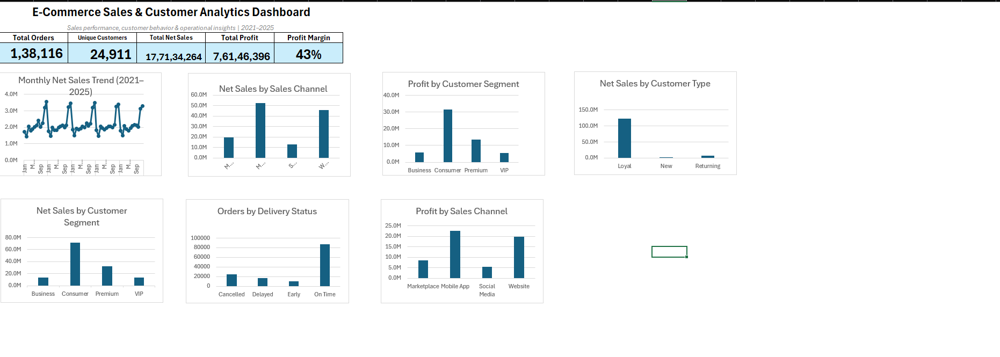
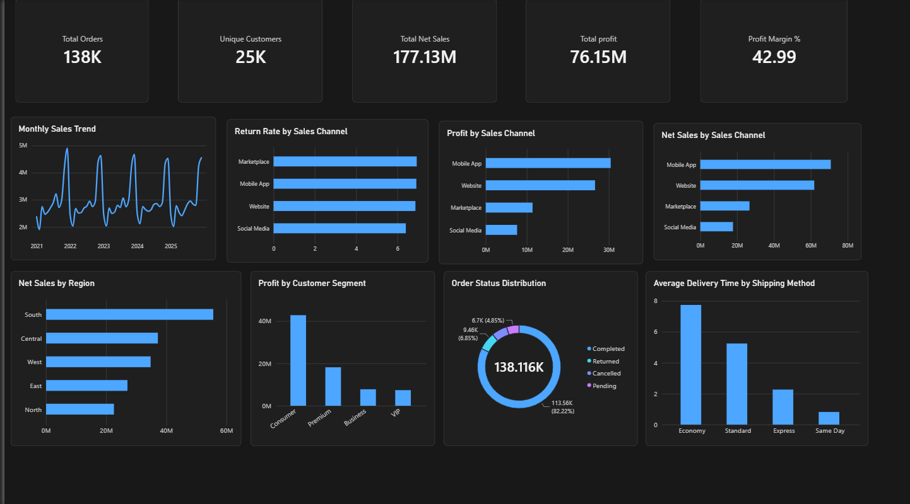

# E-Commerce Sales & Customer Analytics

## Project Overview
An end-to-end data analytics portfolio project analyzing e-commerce sales, customer behavior, profitability, order status, returns, and delivery performance using Excel, SQL Server, and Power BI.

## Tools Used
- **Microsoft Excel:** Data validation, cleaning, PivotTables, charts, and dashboard creation.
- **SQL Server (SSMS):** Data analysis using aggregations, CTEs, window functions, and business queries.
- **Power BI:** Interactive dashboard with KPI cards and visualizations.

## Key Business Insights
- **Order completion:** 82.22% of orders were completed.
- **Sales channels:** Mobile App generated the highest net sales among the sales channels analyzed.
- **Customer segments:** Consumer contributed the highest total profit.
- **Profitability:** Overall profit margin was approximately 42.99%.
- **Returns:** Marketplace had the highest return rate (6.93%), while Social Media had the lowest (6.41%).
- **Delivery:** Average actual delivery time exceeded the estimated time across all shipping methods.

## Project Files
- `Ecommerce_Sales_Analytics.pbix` — Power BI dashboard.
- `SQL Analysis - E-commerce sales project All queries.docx` — SQL queries and business insights.

## Notes
The dataset contains multiple currencies. Financial totals are reported in dataset currency units and have not been normalized to a single currency.

## Author
Created as a data analytics portfolio project to demonstrate skills in Excel, SQL Server, and Power BI.
## Excel Dashboard

## power BI Dashboard

